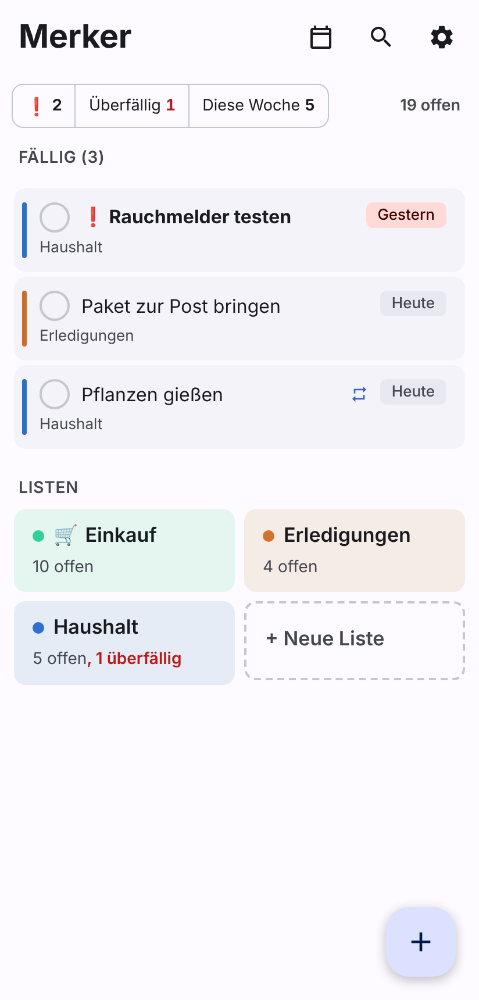
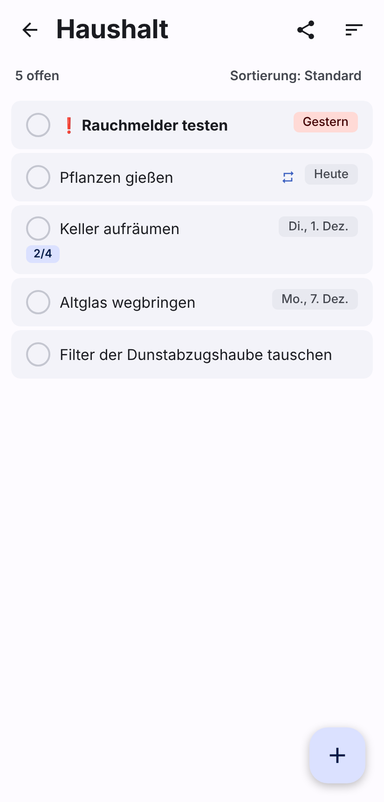
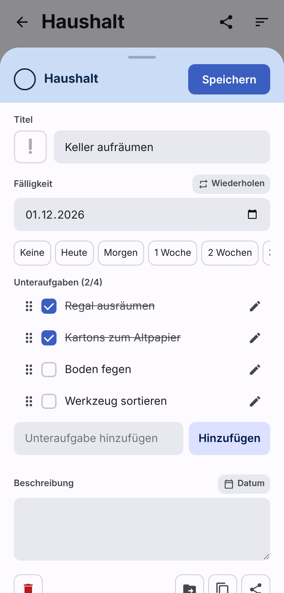
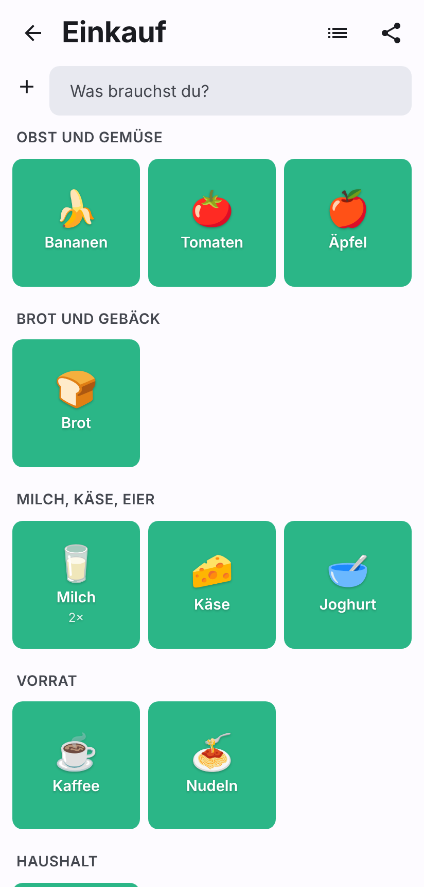
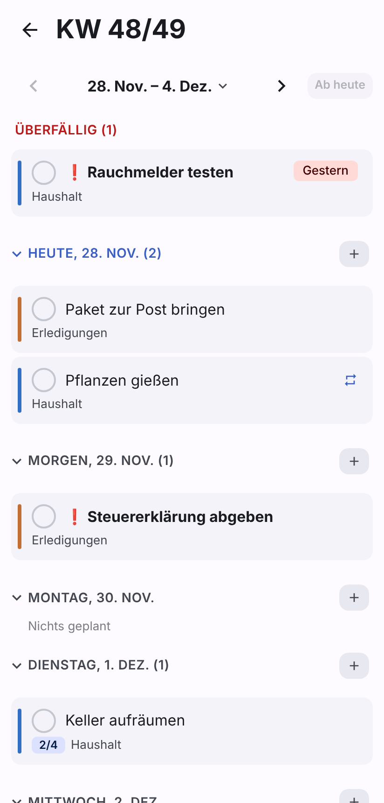
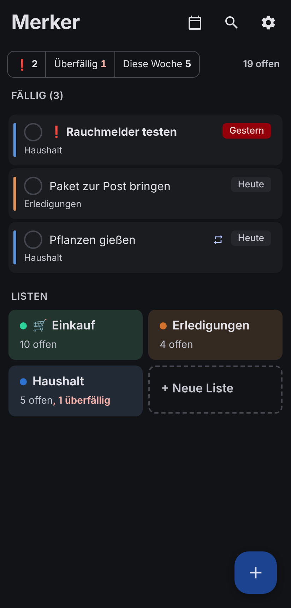

# Merker

**Eine schnelle App fürs Handy für deine To-do-Listen aus Home Assistant.**

Merker ist eine kleine Web-App (PWA), die direkt auf deinem Home-Assistant-Server läuft und mit jeder `todo.*`-Entität funktioniert: Local To-do, Einkaufsliste, CalDAV, Todoist und andere. Du installierst sie auf dem Handy wie eine normale App. Kein zusätzlicher Server, kein Cloud-Konto, kein Tracking.

[English version](README.md)

  
  
  
  

  
  

## Funktionen

- **Fällig über alle Listen:** Überfälliges, Heute und diese Woche auf der Startseite, mit Filtern für Wichtig, Überfällig und Diese Woche. Wochenansicht nach Kalenderwoche.
- **Wischen:** nach rechts erledigen, nach links in eine andere Liste verschieben, löschen oder das Datum ändern (einstellbar), mit Rückgängig.
- **Unteraufgaben, Wiederholung, Priorität:** als normaler Text in der Beschreibung gespeichert und deshalb auch in Home Assistant lesbar (Checkliste `- [ ]`, `🔁 wöchentlich`, `❗` vor dem Titel).
- **Einkaufsansicht:** Liste als Einkaufsliste markieren und große Kacheln mit Bildern bekommen, sortiert nach Abteilung im Laden. Zuletzt Gekauftes ist einen Tipp entfernt. Eigene Bilder und Abteilungen gelten auf allen Geräten desselben HA-Benutzers.
- **Offline:** zeigt ohne Verbindung den letzten Stand und sammelt Änderungen, bis Home Assistant wieder erreichbar ist.
- **Android:** Text oder Links aus jeder App als neue Aufgabe teilen, Kurzbefehle am App-Symbol für "Neue Aufgabe" und die Einkaufsliste, Liste als Text teilen.
- **Außerdem:** Suche über alle Listen, Reihenfolge per Ziehen, Listenfarben, Listen anheften, ausblenden oder deaktivieren, neue lokale Listen anlegen, mehrere Zeilen einfügen für mehrere Aufgaben, Links und Telefonnummern als Knöpfe, hell und dunkel, Akzentfarben, kompakte Ansicht, Tastenkürzel am PC (`/` Suche, `n` neue Aufgabe).
- **Sprachen:** Deutsch und Englisch.

Merker bietet nur an, was die Integration hinter einer Liste kann. Eine Liste nur zum Lesen bleibt nur zum Lesen.

## Voraussetzungen

- Home Assistant mit mindestens einer To-do-Liste (getestet mit aktuellen Versionen).
- Ein Home-Assistant-Benutzer zum Anmelden. Neue Listen anlegen geht nur als Administrator.
- Zugriff auf Home Assistant über HTTPS (zum Beispiel Home Assistant Cloud oder eigenes Zertifikat), damit sich Merker auf dem Handy als App installieren lässt. Im Browser am PC läuft es auch ohne.

## Installation

### Von Hand

1. Dieses Repository herunterladen ("Code" → "Download ZIP") und entpacken.
2. Den Inhalt des Ordners `app` nach `/config/www/merker` auf deinen Home-Assistant-Server kopieren (zum Beispiel mit dem Add-on "File editor" oder "Samba"). Gab es `/config/www` vorher nicht, Home Assistant einmal neu starten.
3. Auf dem Handy in Chrome `https://<dein-home-assistant>/local/merker/index.html` öffnen, mit deinem Home-Assistant-Konto anmelden und im Menü "App installieren" wählen.

Für ein Update die Dateien ersetzen. Merker zeigt dann "Version … verfügbar" und lädt per Tipp neu.

### Automatische Updates aus GitHub

`ha/merker_update.sh` holt die neueste Version aus diesem Repository nach `/config/www/merker` und behält die vorige als Sicherung. Zusammen mit der GitHub-Integration in Home Assistant aktualisiert sich Merker von selbst, sobald ein neuer Commit auf `main` landet. Anleitung Schritt für Schritt: [ha/EINRICHTEN.md](ha/EINRICHTEN.md).

## Datenschutz und Sicherheit

- Merker spricht nur mit deinem Home Assistant, über dieselbe WebSocket-Schnittstelle wie die Oberfläche von Home Assistant. Andere Verbindungen gibt es nicht.
- Die Anmeldung läuft über den normalen Login von Home Assistant. Der Token bleibt in deinem Browser.
- Einstellungen wie Farben und angeheftete Listen liegen auf dem Gerät. Eigene Bilder und Abteilungen für die Einkaufsansicht speichert Home Assistant pro Benutzer.
- Dateien unter `/local/` liefert Home Assistant ohne Anmeldung aus. Wer deinen Home Assistant erreicht, kann also die App-Dateien laden, aber nicht deine Listen. Dafür braucht es eine Anmeldung.

## Grenzen

- Benachrichtigungen: Eine Web-App kann nicht zuverlässig selbst erinnern. Dafür Automationen in Home Assistant mit der Companion App nutzen.
- Wiederkehrende Aufgaben bekommen ihre nächste Runde nur, wenn sie in Merker erledigt werden, nicht in Home Assistant.
- Listen umbenennen oder löschen geht in Home Assistant.
- Neue Listen nur mit Verbindung.

## Wenn etwas hakt

`https://<dein-home-assistant>/local/merker/diag.html` zeigt Version, Service Worker und Caches und kann die App komplett zurücksetzen. Die Seite funktioniert auch, wenn die App selbst nicht startet.

## Entwicklung

Reine ES-Module, kein Framework, kein Build-Schritt. Alles in `app/` wird unverändert kopiert. Befehle und Aufbau stehen im [englischen README](README.md#development). Merker entsteht mit Hilfe von KI (Claude Code, Regeln in `CLAUDE.md`). Bisher gab es mehr als 60 Versionen, ich nutze die App täglich, und sie ist mit 39 Browser-Tests und über 200 Prüfschritten gegen einen nachgebauten Home-Assistant-Server abgesichert.

## Lizenz

[MIT](LICENSE). Enthält [home-assistant-js-websocket](https://github.com/home-assistant/home-assistant-js-websocket) unter der Apache License 2.0 (`app/js/vendor/`).
