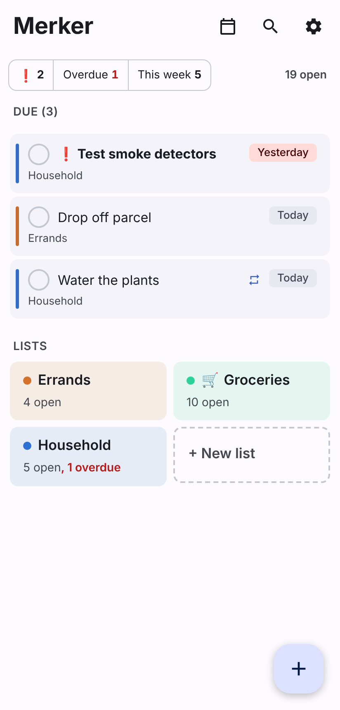
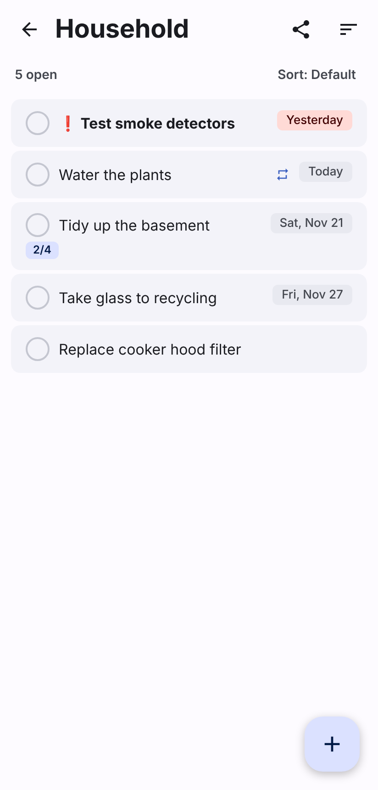
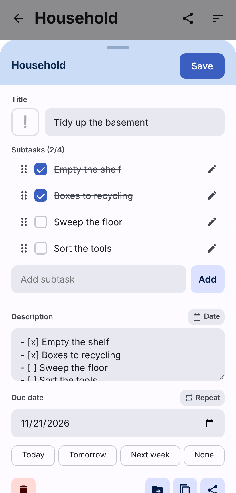
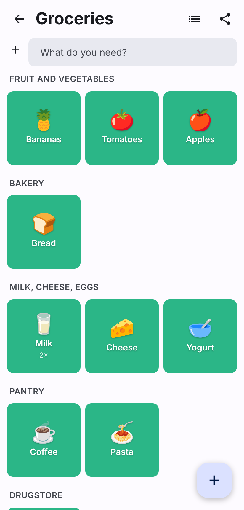
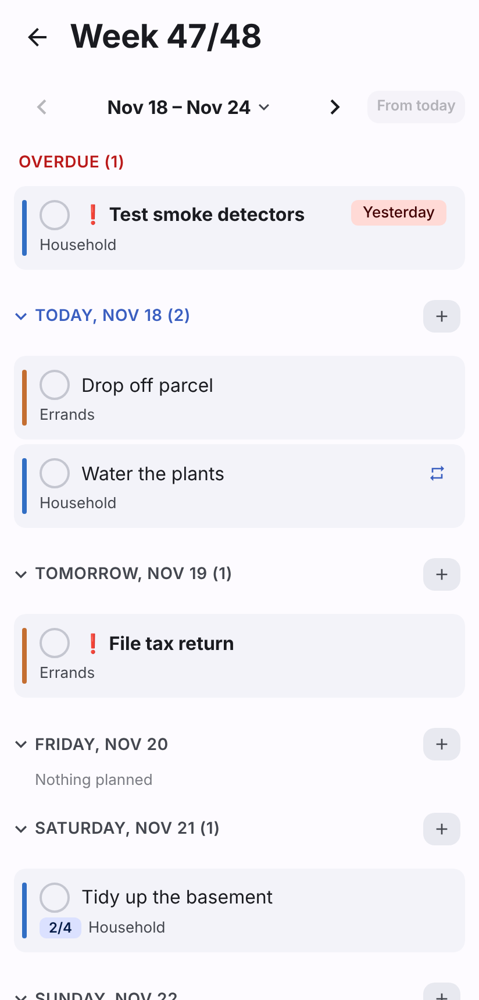
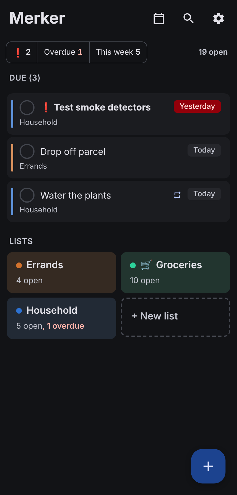

# Merker

**A fast, phone-first app for your Home Assistant to-do lists.**

Merker is a small web app (PWA) that runs directly on your Home Assistant server and works with every `todo.*` entity: Local To-do, Shopping List, CalDAV, Todoist and others. Install it on your phone like a native app. No extra server, no cloud account, no tracking.

[Deutsche Version](README.de.md)

<p>
  
  
  
  
</p>
<p>
  
  
</p>

## Features

- **Due across all lists:** overdue, today and this week on the home screen, with filters for important, overdue and this week. Week view by calendar week.
- **Swipe:** right to complete, left to move to another list, delete or change the date (your choice), with undo.
- **Subtasks, repeat, priority:** stored as plain text in the task description, so they stay readable in Home Assistant (`- [ ]` checklist, `🔁 weekly`, `❗` before the title).
- **Shopping view:** mark a list as a shopping list and get large tiles with pictures, sorted by aisle. Recently bought items are one tap away. Your own pictures and aisles sync across devices of the same Home Assistant user.
- **Offline:** shows the last known state without a connection and queues your changes until Home Assistant is back.
- **Android integration:** share text or links from any app into a new task, app shortcuts for "New task" and the shopping list, share a list as text.
- **More:** search across all lists, drag to reorder, list colors, pin, hide or disable lists, create new local lists, paste several lines to create several tasks, links and phone numbers as buttons, light and dark mode, accent colors, compact view, keyboard shortcuts on desktop (`/` search, `n` new task).
- **Languages:** English and German.

Merker only offers what the integration behind a list supports. A read-only list stays read-only.

## Requirements

- Home Assistant with at least one to-do list (tested with current releases).
- A Home Assistant user to log in. Creating new lists needs an administrator.
- HTTPS access to Home Assistant (for example Home Assistant Cloud or your own certificate) to install Merker as an app on your phone. In a desktop browser it also runs without.

Built and tested for Android with Chrome and for desktop browsers. iOS is not tested.

## Installation

### Manual

1. Download this repository ("Code" → "Download ZIP") and unpack it.
2. Copy the contents of the `app` folder to `/config/www/merker` on your Home Assistant server (for example with the File editor or Samba add-on). If `/config/www` did not exist before, restart Home Assistant once.
3. Open `https://<your-home-assistant>/local/merker/index.html` in Chrome on your phone, log in with your Home Assistant account and choose "Install app" from the menu.

To update, replace the files. Merker shows "Version … available" and reloads on tap.

### Automatic updates from GitHub

`ha/merker_update.sh` downloads the latest version from this repository into `/config/www/merker` and keeps the previous version as a backup. Together with the GitHub integration in Home Assistant, Merker updates itself whenever a new commit lands on `main`. Step by step guide (German): [ha/EINRICHTEN.md](ha/EINRICHTEN.md). The short version:

```yaml
# configuration.yaml
shell_command:
  merker_update: "sh /config/scripts/merker_update.sh"
```

Then call `shell_command.merker_update` from a script, a button or an automation.

## Privacy and security

- Merker talks only to your Home Assistant, through the same WebSocket API the Home Assistant frontend uses. It makes no other network requests.
- Login uses the regular Home Assistant login. The token stays in your browser.
- Settings like colors and pinned lists are stored on the device. Your own shopping pictures and aisles are stored per user in Home Assistant.
- Files under `/local/` are served by Home Assistant without login. That means anyone who can reach your Home Assistant can load the app files, but not your lists. Those need a login.

## Limitations

- Notifications: a web app cannot reliably send reminders on its own. Use Home Assistant automations with the Companion App for that.
- Repeating tasks get their next round only when completed in Merker, not when completed in Home Assistant.
- Renaming or deleting lists is done in Home Assistant.
- New lists need a connection.

## Troubleshooting

`https://<your-home-assistant>/local/merker/diag.html` shows the version, service worker and cache state and can reset the app completely. It also works when the app itself does not start.

## Development

Plain ES modules, no framework, no build step. Everything in `app/` is copied as is.

```
npm run setup      # once: dependencies and Chromium
npm test           # all tests (browser tests against a mock Home Assistant server)
npm run test:one -- e2e33
npm run screenshots           # screenshots for this README
```

- `app/`: the app
- `tests/`: mock Home Assistant server (`mock-ha.mjs`), browser tests (`e2e*.cjs`), tests without a browser (`*.test.mjs`)
- `scripts/`: set the version, build a zip, screenshots
- `ha/`: update script for Home Assistant
- `CHANGELOG.md`: all versions (German)
- `CLAUDE.md`: rules and decisions for working on Merker with Claude Code. Merker is developed with AI assistance and covered by 35 browser tests with more than 200 checks against a mock Home Assistant server.

## License

[MIT](LICENSE). Includes [home-assistant-js-websocket](https://github.com/home-assistant/home-assistant-js-websocket) under the Apache License 2.0 (`app/js/vendor/`).
